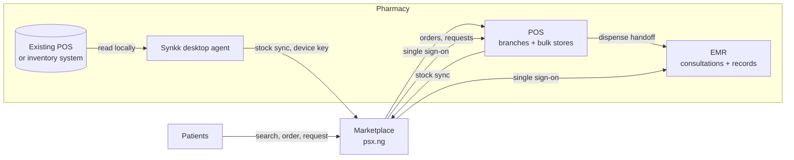

# PharmaStackX: case study

A connected software platform for pharmacies: a patient-facing marketplace, a multi-tenant point of sale, a pharmacy EMR, and a desktop sync agent, all sharing one data layer.

I designed and built all four products end to end, from architecture to UI, and I run them in production. The code is private because it handles live pharmacy and patient data. This page explains what the platform does and how it's built. I'm happy to walk through the code on a call.

---

## The problem

When someone needs a medicine, they usually have no way to tell which nearby pharmacy has it. They go from shop to shop, or go without. Most pharmacies already track their stock, but it sits locked inside their own POS or spreadsheet. Pharmacies with no system at all have nothing to share.

PharmaStackX gets that stock data out, safely, and makes it searchable. For pharmacies without software, it provides the software too.

## The platform

| Product | Role | Stack |
|---|---|---|
| **Marketplace** | Medicine search across pharmacies, orders, requests and quotes, delivery, pharmacy dashboards, admin | Next.js, MongoDB, Pusher, Paystack, PWA |
| **POS** | Multi-tenant point of sale for retail branches and bulk stores | Next.js, MongoDB transactions, NextAuth, IndexedDB (offline cache) |
| **EMR** | Pharmacy consultations, patient records, dispensing | Next.js, Prisma, NextAuth |
| **Synkk** | Desktop agent that syncs stock from a pharmacy's existing software | Electron, TypeScript, React |

---

## Marketplace

- **Medicine search across pharmacies**, ranked by distance, with live stock pulled from every connected pharmacy.
- **Requests and quotes:** a patient asks for a medicine, and nearby pharmacists respond with price and availability in real time.
- **Orders, payment and delivery:** Paystack checkout, courier rates and dispatch through Shipbubble, and a delivery-agent dashboard.
- **WhatsApp intake:** informal requests sent by WhatsApp become structured requests on the platform.
- **Notifications** by push, email and SMS, plus real-time updates for pharmacists and patients.
- **Bulk stock upload** from CSV or Excel, with automatic matching and classification of medicine names.
- **Admin tools:** pharmacy onboarding and verification, order management, prescription review, and analytics.

## POS

A white-label, multi-tenant point of sale. Any number of pharmacies run on one deployment, each with fully isolated data and its own branding.

- **Two kinds of location.** *Retail branches* sell to customers. *Bulk stores* receive stock in bulk packaging, push it down to branches, or sell to wholesalers.
- **Stock you can trust.** Every sale deducts stock inside a database transaction, so two tills can't sell the same last pack.
- **Batches and expiry** tracked per product, with stock transfers, write-offs and reconciliation.
- **Offline-ready.** The product catalogue is cached on the device, so search keeps working when the connection drops. Offline sales are in development.
- **Customers and debtors:** credit sales, payments and balances.
- **Staff:** roles, shifts, and clock-in with biometric devices.
- **Reporting and audit:** sales reports, receipts, refunds, and activity and deletion logs.

## EMR

A pharmacy-level consultation and records system.

- **Structured consultations:** consent, presenting complaint, history, review of systems, assessment, then a management plan (treat, run diagnostics, or refer).
- **Quick dispense:** when a sale at the POS includes a complaint, the EMR creates the encounter automatically.
- **Patient records** across visits, plus **share links** for a single encounter, limited to what's shared (full record, prescription, diagnostics or referral).
- **Single sign-on** with the rest of the platform.

## Synkk

A desktop app that runs on the pharmacy's computer alongside the software it already uses.

- **Reads stock from existing systems**, including local SQL Server, MySQL, PostgreSQL and SQLite databases, and exported files, then syncs changes to the marketplace.
- **Built-in POS and EMR tabs** for pharmacies that have no system of their own.
- **Auto-updates** through a release channel, so every pharmacy runs the latest version.
- **Runs quietly in the system tray**, with status and alerts.

---

## Hard problems I solved

**1. Getting data out of software I don't control.**
Every pharmacy uses different software, and most of it has no API. Synkk connects to whatever is there (a local database, an export file, a web POS) and turns it into one common stock format. That's what lets the marketplace show stock from many different systems at once.

**2. Multi-tenancy without data leaks.**
Every record is scoped by pharmacy, branch and store, and every query enforces that scope. One deployment serves many independent businesses that must never see each other's data.

**3. Accurate stock under concurrency and bad connectivity.**
Stock deduction runs in database transactions, so simultaneous sales can't oversell. Each till caches its pharmacy's catalogue locally (scoped to that pharmacy and branch), so it stays usable on a weak connection.

**4. One identity across four products.**
A pharmacist signs in once and moves between the marketplace, POS and EMR. Desktop installs authenticate separately, each with its own device key.

## Security

The platform handles patient data, so security is part of the design, not an afterthought:

- **Per-device keys for every desktop install.** Each key is tied to one pharmacy and can only read and write that pharmacy's data. Keys are stored only as hashes and can be revoked.
- **No shared or default credentials.** Every service-to-service key comes from the environment, and requests are refused if a key isn't configured.
- **Encrypted local storage** on pharmacy computers, protected by the operating system.
- **Account lockout** after repeated failed logins, with passwords hashed using bcrypt.
- **Tenant isolation** on every query, plus audit logs for sensitive actions.
- **Patient consent** recorded at the start of every consultation. Record share links are cryptographically signed, so they can't be guessed or altered.

## Stack

**Frontend:** Next.js (App Router), React, TypeScript, Tailwind, Material UI
**Backend:** Next.js route handlers, MongoDB (Mongoose and Prisma), Pusher, web push
**Desktop:** Electron, with auto-updates through GitHub Releases
**Integrations:** Paystack, Shipbubble, Twilio, WhatsApp, Resend, Firebase
**Hosting:** Vercel, MongoDB Atlas

---

**Osakpolor (Surge) Ogiemudia** · pogiemudia@gmail.com · [LinkedIn](https://www.linkedin.com/in/osakpolor-ogiemudia-surge-3a00501ab/)
